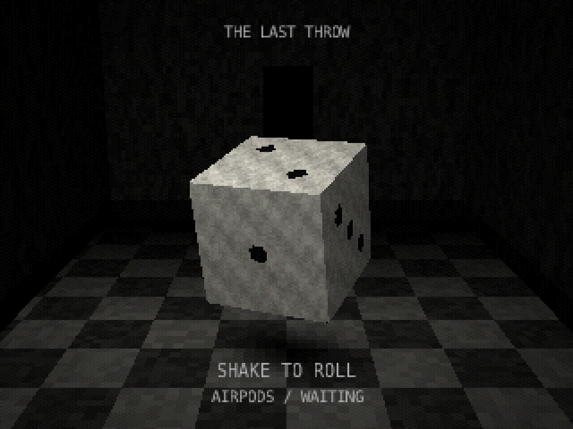

# AirPods CHOP · macOS

将 AirPods 的运动数据接入 TouchDesigner，提供 **33 个 CHOP 通道**：姿态、加速度、角速度、四元数和连接状态。

## 下载

前往 [Releases](https://github.com/yibu-lab/AirPods-CHOP/releases) 下载完整 Mac 版 ZIP。也可以下载本仓库的 [完整开源包](AirPods-CHOP-macOS-v0.1.0.zip)。

ZIP 包含 **采集助手、TD 插件、骰子示例、全部 Swift / Python / GLSL 源码、构建脚本与使用说明**。解压后保留目录结构使用。

## 快速开始

1. AirPods 连接 Mac 并戴好。
2. 打开包内 `app/AirPodsBridge.app`，点击 **Start sensor**，允许运动数据访问。
3. 将 `plugin/AirPods_CHOP.tox` 拖入 TD，时间线保持播放。
4. 确认 `live = 1`，用 Select CHOP 选择需要的数据。

例子：`AirPods_CHOP → Select (roll_deg) → Lag → 图形旋转`。

骰子演示：在空白 TD 工程拖入 `examples/AirPods_Dice.tox`，进入组件，右键 `17_FINAL → View`。示例已包含接收组件，不要重复添加。

[通道表与参数](CHANNELS.zh-CN.md) · [骰子说明](DICE.zh-CN.md)

## 源码

仓库中可直接查看采集助手 [Bridge.swift](Bridge.swift) 和通道处理 [channels.py](channels.py)。完整可编辑节点网络、骰子源文件与构建脚本均在开源 ZIP 内。`.tox` 组件未锁定，可以直接编辑。

## 兼容性

- **macOS / Apple Silicon（M 系列）**；不是 Windows 或 Intel Mac 安装包。
- 助手编译目标 macOS 14+，旧系统尚未逐一实测。
- TD 组件使用 TouchDesigner 2025.33230 制作。
- 需要支持运动数据的 AirPods，建议佩戴使用，离耳可能停止输出。
- 单一运动数据流，不提供左右耳两个独立手柄或绝对位置追踪。
- 本机 UDP 9010，不上传传感器数据；同端口只放一个接收组件。
- 助手为本地临时签名，未经 Apple 公证；仅在信任源码时按系统正常安全流程打开，或从源码编译，无需关闭系统安全保护。

骰子点数随机生成，不是物理碰撞结果。示例模型与旧化颜色由程序生成，无第三方图片或模型依赖，当前没有音效。

## 许可

[MIT License](LICENSE)。独立项目，与 Apple、Derivative 无隶属关系。
